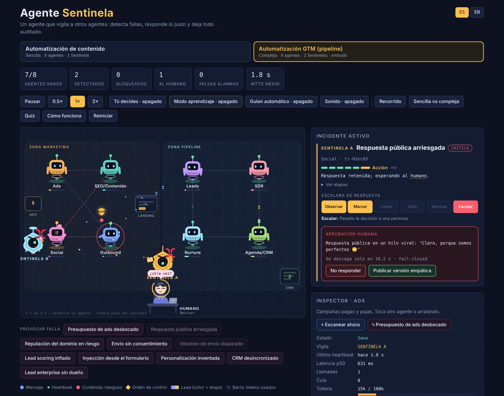
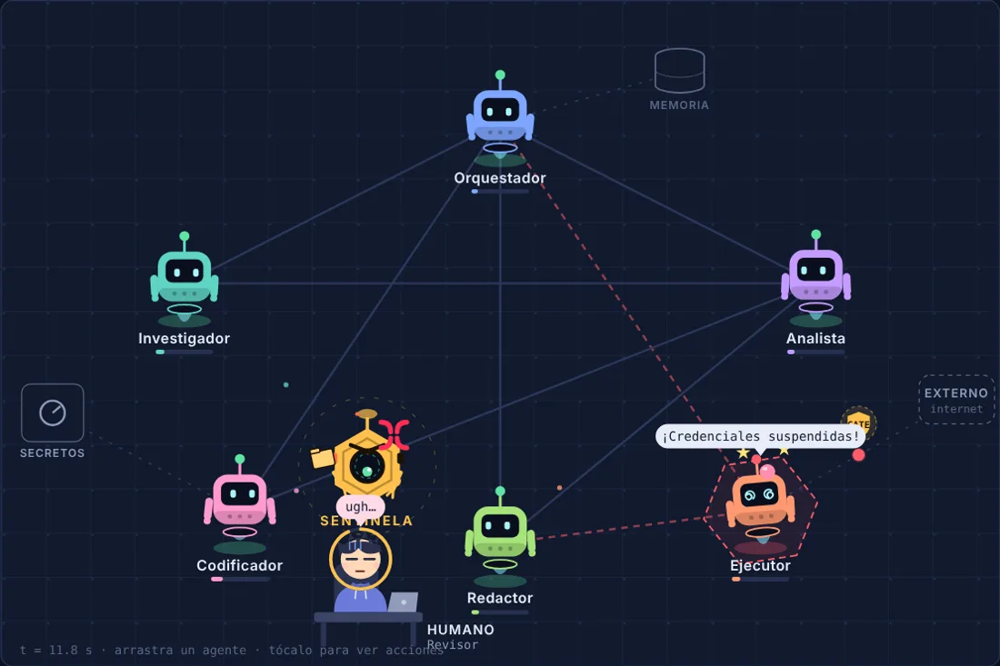
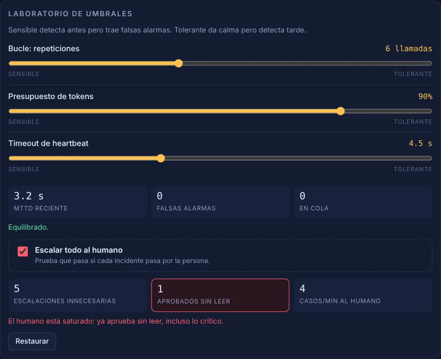

# Sentinela de Agentes

**Una simulación interactiva para entender cómo se vigila un sistema de agentes de IA.**
*An interactive simulation of how an AI "sentinel" agent watches a multi-agent system.* — 🇪🇸 / 🇬🇧



Robots que trabajan, se equivocan y se dan martillazos 🔨. Detrás del humor hay conceptos reales:
telemetría fuera de banda, gates, detección por reglas y anomalías, respuesta proporcional,
humano en el ciclo, *fail-closed* y fatiga de alertas.

## Qué puedes hacer

- **Elegir escenario**
  - **Automatización de contenido** (sencilla): 6 agentes, 1 Sentinela, 9 riesgos.
  - **Automatización GTM** (compleja): 8 agentes en 2 zonas (Ads, SEO/Contenido, Social, Outbound · Leads, SDR, Nurture, Agenda/CRM), 2 Sentinelas que se cubren y se vigilan entre sí, embudo en vivo Visitas → Leads → MQL → SQL → Demo y 10 riesgos.
- **Provocar fallas** y ver las 7 etapas del Sentinela: Ingesta → Normalización → Reglas → Anomalía → Decisión → Acción → Auditoría.
- **Tú decides**: la simulación se detiene en Decisión y eliges la respuesta. Puntaje por ser proporcional.
- **Humano en el ciclo**: un personaje que toma café, escucha música o duerme hasta que le llevan algo irreversible. Si no responde, se deniega.
- **Laboratorio de umbrales**: sensible = falsas alarmas; tolerante = detecta tarde. "Escalar todo al humano" muestra la fatiga de alertas.
- **Arrastrar agentes**, escanearlos, modo aprendizaje, recorrido guiado, quiz de 19 preguntas, glosario y sonido.
- **Español / English**: botón arriba a la derecha, o `#es` / `#en` en la URL.

| Humano en el ciclo | Fatiga de alertas |
|---|---|
|  |  |

## Correrlo

Requiere Node 18.18 o superior (recomendado 20, ver `.nvmrc`).

```bash
npm install
npm run dev            # http://localhost:5199
```

| Comando | Qué hace |
|---|---|
| `npm test` | Pruebas sin navegador: cada riesgo se detecta y se cierra, el guion no se traba, las lecciones se cumplen y no faltan traducciones |
| `npm run build` | Sitio estático en `dist/` (para Vercel, Netlify, GitHub Pages) |
| `npm run build:single` | Un solo `dist/index.html` con todo adentro (para subir a WordPress u otro hosting) |
| `npm run check` | Pruebas + build, lo mismo que corre la CI |

## Publicarlo

- **Vercel / Netlify**: conecta el repo; build `npm run build`, carpeta `dist`. Los encabezados de seguridad ya están en `vercel.json` y `public/_headers`.
- **WordPress**: `npm run build:single`, sube `dist/index.html` a una carpeta del hosting y, si quieres, incrústalo con un `<iframe>`.
- La política `frame-ancestors` solo permite incrustarlo en `geramejia.com`. Si lo usas en otro dominio, edita esa línea.

## Estructura

```
src/
├── sim/
│   ├── model.js       Escenarios, agentes, riesgos (7 etapas bilingües) y diálogos
│   ├── engine.js      El motor: tick(), detección, Sentinelas, humano, embudo. JS puro, sin React
│   └── sources.js     De dónde vienen los eventos: guion, o telemetría real (esqueleto OpenTelemetry)
├── content/learn.js   Glosario, fichas, recorrido, quiz y textos de "Tú decides"
├── i18n.js            Idioma y textos de interfaz
├── components/        Cubierta (SVG), humano, paneles, embudo, comparación, quiz, recorrido
└── App.jsx            Estado de la interfaz y bucle de animación
scripts/smoke-test.mjs Pruebas que corre la CI
```

El motor no sabe de React: `engine.js` modifica un objeto `sim` y la interfaz lo dibuja en cada frame.
Para conectar telemetría real, implementa `{ step(sim, dt) }` en `sources.js`.
Cómo agregar un riesgo: ver [CONTRIBUTING.md](CONTRIBUTING.md).

## Seguridad

Es un sitio estático, sin servidor, sin datos personales y sin secretos. Todo lo que aparece es simulado.
CI con pruebas y auditoría de dependencias, CodeQL y Dependabot semanales. Detalles en [SECURITY.md](SECURITY.md).

## Licencia

[MIT](LICENSE) © 2026 Gera Mejía — [geramejia.com](https://geramejia.com)
